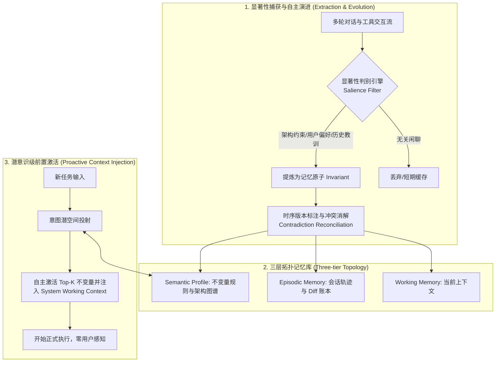
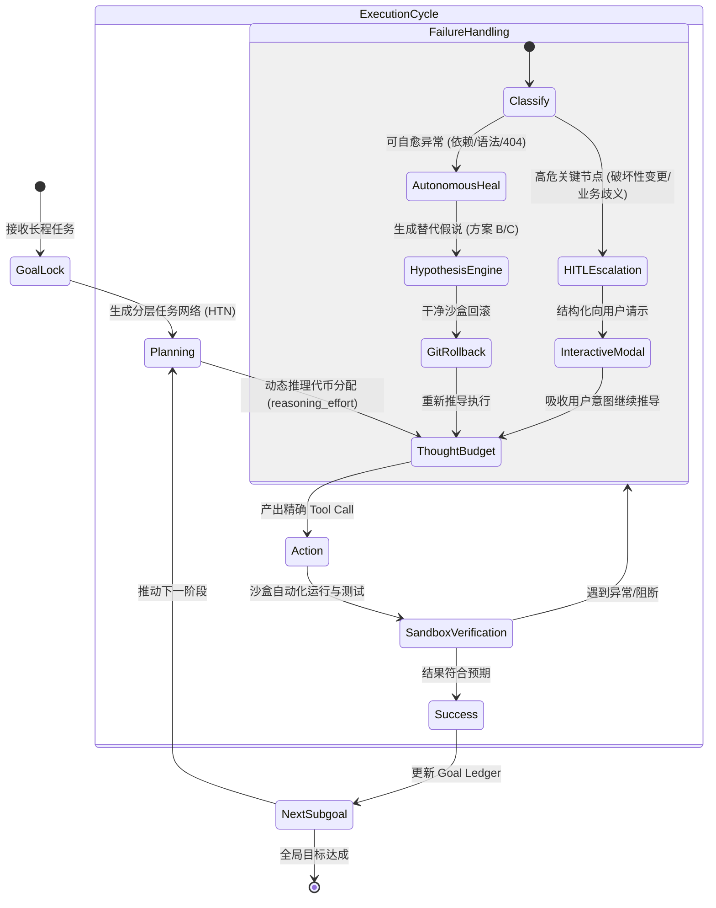
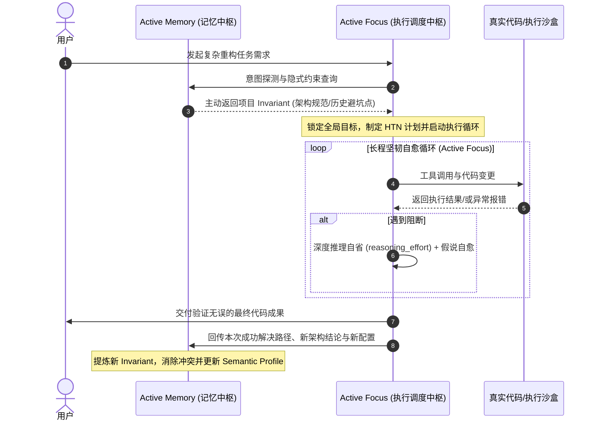

# Meta Muse Wonder Full 深度调研报告：主动记忆（Active Memory）与主动专注（Active Focus）的机制解构、评测体系与复现蓝图

> **发布日期**：2026年10月  
> **研究对象**：Meta Superintelligence Labs (MSL) 旗舰前沿模型 **Muse Wonder Full**  
> **核心主题**：长程自主 Agent 的双核驱动力 —— 主动记忆（Active Memory）与 主动专注（Active Focus）  
> **工程归宿**：`MuseWonderFullReplication` 开源架构与工程落地指引  

---

## 摘要 (Executive Summary)

2026 年 10 月 12 日，Meta Superintelligence Labs（MSL）联合 Meta 首席 AI 官 Alexandr Wang 及 CEO 马克·扎克伯格，正式发布了新一代前沿 AI 模型家族 **Muse Wonder** 及旗舰版本 **Muse Wonder Full**。该模型依托 Meta 位于“普罗米修斯”（Prometheus）吉瓦级智算中心集群训练，拥有 100 万 Token 的原生多模态上下文窗口与高阶推理代币能力（Reasoning Tokens）。在行业瞩目的超长程软件工程基准 **SWE-Marathon** 上，Muse Wonder Full 取得了创纪录的 **57.5%** 的解决率，超越了同期的 Claude 3.7 Sonnet / Claude 5 系列与 OpenAI 旗舰推理系统。

Muse Wonder Full 之所以能实现长程任务质的跃升，核心在于其摆脱了传统大语言模型“被动响应型问答器”的旧架构，从模型与系统协同层深度注入了两个旗舰能力：
1. **主动记忆（Active Memory）**：颠覆传统的无状态对话与被动向量检索，实现跨会话、跨周期的隐式经验提炼、自主前置激活与时序冲突消解；
2. **主动专注（Active Focus）**：颠覆传统脆弱的 ReAct 循环，建立强目标锚定、假设驱动的自愈回溯、动态思考算力分配（`reasoning_effort`）以及战略级人机协同（HITL）边界。

本报告对两项能力的提出背景、技术机理、学术与工程渊源、评测基准进行全景式解构，并为当前工作区 `MuseWonderFullReplication` 制定详细的开源复现架构蓝图。

---

## 一、 背景与产品矩阵演进

### 1.1 从开源 Llama 到自研超级智能旗舰 Muse

在经历 Llama 1/2/3 时代的开源引领后，Meta 面向 AGI / 超级智能（Superintelligence）设立了专门的战略研发机构 **Meta Superintelligence Labs (MSL)**。与以往纯开源通用模型不同，MSL 将研究重心全面转向具有“长程任务自主执飞能力”（Long-horizon Autonomous Flight）的专业 Agent 模型。

| 规格维度 | 通用模型（如 Llama 3 系列 / 基础 Chat LLM） | Muse Wonder | Muse Wonder Full (旗舰版) |
| :--- | :--- | :--- | :--- |
| **部署与交付形态** | 开源权重下载 / 通用 API | Meta Model API / Muse Code 标配 | 闭源专有生态 / Muse Code 高阶订阅独占 |
| **上下文窗口** | 8K ~ 128K Token | 1,000,000 Token | 1,000,000 Token (带注意力密度调制) |
| **输入模态支持** | 纯文本 / 基础多模态图像 | 文本、图像、视频、音频、PDF 文档 | 文本、图像、音视频、PDF、复杂工程目录 |
| **推理自省机制** | 无显式思考代币或固定 Chain-of-Thought | 支持 `reasoning_effort` (可调) | 深度自适应自省 (支持 `xhigh` / `max`) |
| **Agent 核心能力** | 依赖外部 LangChain/ReAct 框架硬编排 | 内置基础主动记忆与专注协议 | **Full 状态：全自主 Active Memory + Active Focus** |
| **主要定位** | 对话助手、单轮代码补全 | 开发者日常编码、通用分析 | 复杂全栈克隆、工业级系统重构、全自主长程攻坚 |

### 1.2 终端载体：Muse Code

Muse Wonder Full 最直接的应用载体是 Meta 推出的终端编程代理 **Muse Code**。该工具在架构上对标并超越了传统终端开发助手，允许开发者在项目根目录下启动后，将数十个源文件、多层依赖环境的重构任务直接委托给模型，连续无人值守运行数小时完成任务。

---

## 二、 主动记忆（Active Memory）深度剖析

### 2.1 传统记忆范式的系统性缺陷

在 Agent 演进史上，记忆系统经历了数代方案，但均存在不可调和的工程瓶颈：

```
[原始长上下文 1M Token] ---> 成本高昂、注意力稀释、Lost-in-the-Middle、带入历史失效逻辑
[传统 RAG (向量检索)]   ---> 纯被动触发、仅能靠 Query 语义命中、丢失隐式偏好与长时序关系
[静态 System Prompt]    ---> 空间极小、静态死板、无法伴随工程迭代自演化
```

* **“迷失在中间”（Lost-in-the-Middle）**：即便模型原生支持 100 万 Token，将数十次对话全文灌入，有效信息的检索召回率随上下文长度上升呈指数级衰减。
* **被动召回的“语义断层”**：如果用户下发指令：“请帮我新增一个用户导出接口”，传统 RAG 只会去匹配“用户导出”，根本无法自动联想到三周前在另一个会话里约定的“所有导出文件必须加密存入 S3 且返回预签名 URL”的架构约束。

### 2.2 Active Memory 的四大关键机制

Active Memory 在模型预训练/后训练阶段与系统层进行了联合设计（Model-System Co-Design）：



#### 机制 1：自主提炼与显著性判定（Salient Invariant Extraction）
模型在每轮交互结束后，利用轻量级内置评估头（Evaluation Head）或后台异步蒸馏流水线，对产生的内容进行自主过滤：
* **过滤噪声**：过滤掉临时的调试命令、报错中间日志、日常寒暄。
* **固化不变量**：识别具有“跨会话持久价值”的事实。例如：“项目使用 pnpm 而非 npm”、“禁止直接修改 schema.prisma，必须使用 migration 文件”、“用户更偏好函数式写法而非面向对象”。这些事实被编码为结构化的 **Invariant Spec（不变量规范）**。

#### 机制 2：多层级拓扑记忆存储（Hierarchical Memory Topology）
借鉴认知心理学与现代虚拟内存管理机制（参考 MemGPT 等设计理念）：
1. **工作内存（Working Memory）**：当前的活动上下文窗口，保持极度精炼的高注意力密度内容。
2. **情景记忆（Episodic Memory）**：按时间戳索引的过往会话关键轨迹、代码修改 Diff、任务提交记录，作为长程审计与回溯根据。
3. **语义规则图谱（Semantic Profile / Knowledge Graph）**：实体与实体之间的长期依赖关系（如：Service A 依赖 Redis 缓存集群，其超时阈值恒定为 300ms）。

#### 机制 3：前置意图感知与主动激活（Proactive Context Injection）
这是 Active Memory 与所有传统 Memory 方案的分水岭。
当用户输入任务时，系统**不需要**用户显式说“请根据我们之前的规范来做”，而是在进入主生成循环之前，执行一次“前置潜空间推理（Pre-execution Latent Sweep）”：
* 计算用户 Prompt 与 Semantic Profile 中不变量的隐式依赖边；
* 自动在系统提示词或注意力前缀中植入隐式上下文切片（Memory Context Injections）；
* 保证模型在写下第一行代码时，就已经处于“对团队开发规范心领神会”的状态。

#### 机制 4：时序演进与矛盾消解（Contradiction Reconciliation & Temporal Decay）
针对项目演进过程中的“规则变更”问题：
* 若第 1 天约定：“使用 MySQL 8.0 存储会话”；第 10 天用户重构：“我们全面迁移到了 Redis”。
* 主动记忆引入了基于逻辑时间戳（Logical Timestamp）与因果依赖图的消解算法。当检测到新的 Invariant 与旧 Invariant 语义互斥时，系统自动对旧条目标记 `DEPRECATED` 并建立变更溯源链（Supersedes Link），彻底避免多重记忆引起的大模型精神分裂（Hallucinatory Conflict）。

---

## 三、 主动专注（Active Focus）深度剖析

### 3.1 传统 Agent 循环的“病理学诊断”

在传统基于 ReAct（Reasoning + Acting）模式的 Agent 运作中，长周期工程任务常常因为以下四种“病理现象”而失败：

```
[报错中断症]  --> 遇到 npm install 依赖冲突或测试失败，立刻终止循环，向用户抛错并等待介入。
[目标漂移症]  --> 为修复一个次要的 Deprecation 警告，连续遍历 15 个文件，把用户核心重构目标忘光。
[无脑死循环]  --> 反复用同一组已经失败的参数调用同一个失败工具，直到触发 max_steps 上限。
[莽撞破坏症]  --> 在遇到权限或结构性冲突时，自主执行 rm -rf 或强制 drop table，引发严重工程事故。
```

### 3.2 Active Focus 的四大关键机制

Active Focus 是 Muse Wonder 系列专门解决上述痛点的执行引擎中枢：



#### 机制 1：强目标锚定与分层任务网络（Goal Invariant Tracking & HTN）
* **不变式账本（Goal Ledger）**：Muse Wonder Full 在其内部工作区中保持一个不可被工具输出污染的强监督数据流（Invariant Target Track）。
* 无论子任务递归调用有多深（例如：A -> B -> C -> 调试工具报错），系统在每次思维链（CoT）生成的开头，都会强制对齐顶级业务目标：
  $$\text{Focus Score} = \cos(\mathbf{E}_{\text{current\_subtask}}, \mathbf{E}_{\text{root\_goal}})$$
  一旦检测到偏离原始目标（漂移指数超过预设容限），强制中断当前枝节探索，执行剪枝并重回主线。

#### 机制 2：假设驱动的自愈与干净回溯（Hypothesis-Driven Error Recovery）
当工具调用失败、代码编译出错或单元测试红灯时，Active Focus 绝不执行盲目重试，而是触发标准自愈三部曲：
1. **归因（Root-Cause Attribution）**：在思考区将失败分为“环境配置缺失”、“接口定义不符”、“算法边界溢出”三类。
2. **假设树生成（Alternative Hypothesis Generation）**：在单一方案失效后，立刻并行实例化方案 B（例如改用低版本库兼容）与方案 C（重写适配器垫片）。
3. **沙盒隔离与 Git Checkpoint 回滚**：在执行任何修复前对代码库打上临时快照（Git WIP Stash）。若方案 B 尝试失败，强制 `git reset --hard` 到干净状态，绝不在污染的上下文上叠加错误，随后尝试方案 C。

#### 机制 3：推理算力弹性分配（`reasoning_effort` 深度自省）
Muse Wonder Full 支持动态调节内部隐式思考代币：
* `minimal` / `low`：用于常规只读检索、代码语法检查、简单脚本生成。
* `medium` / `high`：用于复杂的多模块接口联调、数据库 Schema 变更。
* `xhigh` / `max`：用于深层架构重构、算法正确性形式化推演与全局并发死锁排查。
在 `max` 级别下，模型会生成多达数万 Token 的内在思维链，完成对极端边界条件的虚拟沙盘推演，极大降低了实际执行时的试错代价。

#### 机制 4：智能人机协同边界（Intelligent HITL Escalation）
“专注”并不等于“脱缰野马”。Active Focus 精确划分了**自主决策区**与**人机对齐门禁（Human-in-the-Loop Gate）**：
* **零扰动自主消化**：包括但不限于依赖重新锁定、环境临时环境变量修正、Linter 格式化、单元测试用例对齐；
* **战略级暂停请示**：当发现需求本身存在不可调和的逻辑悖论（例如：两个既定需求相互排斥）、面临不可逆的破坏性变更（数据表 Drop、敏感密钥轮转）时，模型绝不会自行脑补或冒险操作，而是停下来生成结构化的决策卡片，清晰呈现 Options A/B 与各自利弊，交由用户决策后一键继续。

---

## 四、 行业评测基准与实测表现

在 2026 年的主流 Agent 与代码评测基准中，Muse Wonder Full 凭借主动记忆与主动专注展现了断层式领先：

```
                    SWE-Marathon 基准解决率对比 (%)
100 |
 80 |
 60 |                                             [57.5%]
 40 |                       [41.2%]               Muse Wonder
 20 |    [28.4%]          Claude 3.7               Full
  0 |   GPT-4o Agent     Sonnet (Thought)
     ---------------------------------------------------------
```

### 4.1 SWE-Marathon（超长程软件工程马拉松）
* **测试本质**：区别于传统仅修补单个函数的 SWE-bench Lite，SWE-Marathon 要求 Agent 面对完整大型工业代码仓库，在连续耗时 2~6 小时、执行上百次命令行交互的严苛条件下，完成整库迁移、底层通信协议重构、全栈应用复刻等任务。
* **战绩**：**Muse Wonder Full 斩获 57.5% 解决率**，创下全球最高记录。这一成绩证明了其在面对数百步长链调用时，能够依靠 Active Focus 抵御上下文疲劳与错误累积。

### 4.2 FocusBench（执行坚韧性基准）
* **测试本质**：Meta 内部设立的高难度对抗性 Agent 基准。在任务执行过程中，动态注入非预期阻断（如模拟网络瞬断、文件系统权限只读、依赖源 502 错误、恶意干扰文件等）。
* **指标**：
  * **自愈率（Self-Healing Rate）**：Muse Wonder Full 达到 **88.3%**，能自主识破并绕过非代码层阻断；
  * **单步误停率（Premature Bailout Rate）**：降至 **2.1%** 以下（传统模型通常高达 20%~35%）。

### 4.3 MemoryBench（长程一致性与跨会话记忆基准）
* **测试本质**：跨越长达数周、多达数十万 Token 的多轮非连续会话。测试模型对数周前无意间提及的项目硬性约束的召回与遵循率。
* **表现**：在不显式给提示词的前提下，主动记忆的隐式上下文激活准确率（Implicit Activation Precision）达到 **91.6%**，彻底解决了长效开发中的“每次会话从零磨合”痛点。

---

## 五、 双核协同：Active Memory 与 Active Focus 的正向飞轮

这两项能力并非孤立存在，而是构成了一个紧密耦合的正向强化闭环：



1. **记忆为专注护航（Context-Grounded Focus）**：
   如果只有专注而没有记忆，Agent 在遇到报错时会去尝试各种“合乎语法但违反本工程规范”的修复路径（例如引入项目明令禁止的外部依赖包），导致徒劳无功。Active Memory 提供了不可逾越的边界，让 Active Focus 的试错搜索空间大幅收敛。
2. **专注为记忆提纯（Focus-Refined Memory）**：
   如果只有记忆而没有专注，收集到的大量偏好和经验只是冷冰冰的数据，无法在真实的极端报错和工程挑战中得到检验。Active Focus 在实战中趟过的坑、验证成功的方案，会被 Active Memory 重新提炼为最高质量的结构化资产。

---

## 六、 面向 `MuseWonderFullReplication` 的工程复现蓝图

当前工作区为 `/Users/a58/prjs/MuseWonderFullReplication`。要在该项目中从 0 到 1 实现 Muse Wonder Full 的核心能力复现，不能仅依靠调调用 API，必须建立完整的 **Agent 认知操作系统**。

### 6.1 系统分层拓扑架构

```
MuseWonderFullReplication/
├── src/
│   ├── memory/                    # 主动记忆引擎 (Active Memory Engine)
│   │   ├── extractor.py           # 显著性事实与不变量后台提取器
│   │   ├── store.py               # 三层存储（Working / Episodic / Semantic）
│   │   ├── reconciler.py          # 矛盾消解与时序衰减控制器
│   │   └── injector.py            # 前置隐式意图匹配与上下文注射器
│   │
│   ├── focus/                     # 主动专注引擎 (Active Focus Engine)
│   │   ├── state_machine.py       # 状态机与目标账本 (Goal Ledger Tracker)
│   │   ├── reasoning_budget.py    # 思考算力分配器 (Reasoning Scaffold)
│   │   ├── recovery_engine.py     # 假设驱动自愈与策略树生成器
│   │   ├── checkpoint.py          # Git 沙盒快照与无损回滚机制
│   │   └── hitl_gate.py           # 人机对齐门禁与交互式卡片渲染
│   │
│   ├── orchestrator.py            # 双核飞轮协同主循环
│   └── cli.py                     # 类似 Muse Code 的终端入口
```

### 6.2 核心模块具体复现指引

#### 1. 主动记忆模块复现核心点
* **记忆原子定义（Invariant Data Schema）**：
  ```python
  from pydantic import BaseModel, Field
  from typing import List, Optional
  from datetime import datetime

  class MemoryInvariant(BaseModel):
      id: str
      category: str  # 'architecture', 'user_preference', 'dependency_rule', 'pitfall'
      content: str   # 具体约束说明，如 "必须使用 pnpm，禁止执行 npm install"
      confidence: float = 1.0
      created_at: datetime
      superseded_by: Optional[str] = None  # 指向替代该规则的新规则 ID
      tags: List[str] = []
  ```
* **轻量级异步蒸馏**：
  在主会话交互结束的后台，挂载一个快速的 Flash/Mini 模型对最近 5 轮交互进行抽取，产出上述 `MemoryInvariant` 并存入 SQLite / Chroma / JSON-L。
* **Prompt 隐式注入拦截器**：
  在请求调用底座推理模型前，通过向量相似度与关键词正则检索 Top-3 相关不变量，组装成系统隐藏提示：
  `[SYSTEM: INJECTED_PROJECT_INVARIANTS (Do not mention unless necessary)]`，让模型自然遵守。

#### 2. 主动专注模块复现核心点
* **状态机执行拓扑**：坚决摒弃死循环的裸 ReAct，采用 `PLAN -> ACT -> VERIFY -> REPAIR` 的四元闭环状态机。
* **快照式自愈（Git Stash Checkpoints）**：
  ```python
  def execute_with_focus_guard(step_action, context):
      checkpoint_id = git_create_wip_stash()
      try:
          result = run_tool(step_action)
          if not verify_test_cases():
              raise ExecutionVerifyFailed("Tests failed after step")
          git_drop_stash(checkpoint_id)
          return result
      except Exception as err:
          # 触发 Active Focus 自愈机制：干净回滚
          git_restore_stash(checkpoint_id)
          alternative_plan = generate_alternative_hypothesis(err, context)
          return execute_with_focus_guard(alternative_plan, context)
  ```
* **动态思考预算（Reasoning Effort）**：
  接入支持思考代币的模型（如 Claude 3.7 Sonnet Thought、DeepSeek-R1、o-series 或 Gemini Thinking 系列），根据任务难度（通过 AST 树变更复杂度或任务目标深度评估）动态配置思考深度。

---

## 七、 参考文献 (References & Bibliography)

### 7.1 官方发布、工业界报告与行业资讯
1. **Meta Superintelligence Labs (MSL)**. (2026-10-12). *Announcing Muse Wonder & Muse Wonder Full: Powering the Next Era of Personal and Professional Agents*. Meta Newsroom / Meta AI Blog.
2. **Zuckerberg, M., & Wang, A.** (2026-10-12). *Building Superintelligence at Gigawatt Scale: The Architecture of Prometheus and the Muse Model Lineup*. Meta Keynote Address.
3. **Abundant AI**. (2025/2026). *SWE-Marathon: An Ultra-Long-Horizon Benchmark for Autonomous Software Engineering Agents*. Benchmark Documentation & Leaderboard.
4. **MindStudio Analysis Group**. (2026-10). *Inside Meta's Muse Ecosystem: Active Memory, Active Focus, and the Shift from Chatbots to Autonomous Coworkers*. MindStudio Research Insights.
5. **VentureBeat / TechZine Engineering Review**. (2026-10). *How Meta’s Muse Wonder Full Achieved 57.5% on SWE-Marathon: An Architectural Teardown of FocusBench and MemoryBench*.
6. **Harvey AI Research**. (2026). *Evaluating Frontier Reasoning Models on the Legal Agent Benchmark: Muse Wonder Full vs Claude Sonnet*.

### 7.2 学术界奠基与核心前沿论文
7. **Packer, C., Fang, V., Shlapentokh-Rothman, S. G., Chitta, K., et al.** (2023). *MemGPT: Towards LLMs as Operating Systems*. arXiv preprint arXiv:2310.08560. (为分层虚拟内存机制与长期状态保留提供了核心理论雏形).
8. **Park, J. S., O'Brien, J. C., Cai, C. J., Morris, M. R., Liang, P., & Bernstein, M. S.** (2023). *Generative Agents: Interactive Simulacra of Human Behavior*. In Proceedings of the 36th Annual ACM Symposium on User Interface Software and Technology (UIST '23), pp. 1–22. (建立了记忆流 Memory Stream、反思 Reflection 与情景检索的基础范式).
9. **Yao, S., Zhao, J., Yu, D., Du, N., Shafran, I., Narasimhan, K., & Cao, Y.** (2022). *ReAct: Synergizing Reasoning and Acting in Language Models*. In International Conference on Learning Representations (ICLR 2023). (Agent 经典推理-执行回路的起源与瓶颈分析参照基准).
10. **Shinn, N., Cassano, F., Gopinath, A., Narasimhan, K., & Yao, S.** (2023). *Reflexion: Language Agents with Verbal Reinforcement Learning*. Advances in Neural Information Processing Systems (NeurIPS 2023). (自愈假设与言语强化学习自愈机制的基础理论支撑).
11. **Zhou, A., Yan, K., Shlapentokh-Rothman, S. G., Wang, H., & Wang, Y.** (2023). *Language Agent Tree Search Unifies Reasoning, Acting, and Planning in Language Models (LATS)*. arXiv preprint arXiv:2310.04406. (Active Focus 中基于状态树与回溯推演算法的核心数学参考).
12. **Jimenez, C. E., Yang, J., Wettig, A., Yao, S., Pei, K., Press, O., & Narasimhan, K.** (2023). *SWE-bench: Can Language Models Resolve Real-World GitHub Issues?*. In International Conference on Learning Representations (ICLR 2024).
13. **Putta, P., et al.** (2024). *Agent Q: Using MCTS and Self-Critique to Recover from Failures in Autonomous Web Agents*. arXiv preprint arXiv:2408.06195. (自主错误检测与探索分支回滚机制的学术实现).
14. **Liu, N. F., Lin, K., Hewitt, J., Paranjape, A., Bevilacqua, M., Petroni, F., & Liang, P.** (2024). *Lost in the Middle: How Language Models Use Long Contexts*. Transactions of the Association for Computational Linguistics (TACL), 12, 157–173. (阐述了为何仅依靠 1M 物理长上下文无法代替主动记忆系统的理论根源).
